[English](README.md) | **Русский**

# SwitchLens

**Текущая v0.1.4:** штатная авторизация восстановлена; low/fast/auto без таймера сохранены. Доступ без входа v0.1.3 на устройстве не сработал, исключение удалено. Установка нового BIN ещё не подтверждена. [BIN](releases/v0.1.4/README.ru.md).


Read-only JSON telemetry for the **TP-Link TL-SG1218MPE(UN) V5.0**.

Цель проекта — один динамический `GET /stats.json` со статистикой портов,
PoE и информацией о коммутаторе для последующего сбора в Prometheus.
Репозиторий: [adsdevdoo/switchlens-sg1218](https://github.com/adsdevdoo/switchlens-sg1218).

**Продолжение в новом чате:** [контекст проекта и следующий шаг](docs/CONTEXT.ru.md).

**Проверено:** собран прошивочный BIN с MIPS-обработчиком
`/stats.json`, адаптером RAM/ASIC и патчем штатного HTTP-роутера. Машинный код
прошёл тесты в Unicorn вместе со штатными HTTP-функциями; сокет и показания
оборудования в тесте синтетические. Исходники: [target](target/),
[сборщик](tools/build_firmware.py), [тесты](tests/test_target.py).

**Проверено на устройстве 17.10.2026:** v0.1.1 прошёл штатное web-обновление,
запустился, принимает `help` через UART и выдаёт `/stats.json`. Два полных
ответа проходят схему, содержат 18 портов и меняющиеся счётчики.
**[Подробный справочник JSON](docs/JSON-API.ru.md)** ·
**[Хронология испытания, сообщения, 8 скриншотов и оба JSON](docs/evidence/2026-10-17-switchlens/README.ru.md)**.
PoE под нагрузкой, точность всех метрик, длительная работа и восстановление
ещё не проверены.
Это рабочая прошивка с подтверждёнными загрузкой, UART и JSON на стенде владельца.
Сборка, точные границы проверки и оставшиеся неизвестные:
[FIRMWARE](docs/FIRMWARE.ru.md).

**v0.1.2: консоль и тест GPIO27 подтверждены на устройстве.** [BIN и проверки](releases/v0.1.2-cooling/README.ru.md), [команды `cool`](docs/COOLING-CONTROL.ru.md). Получено чтение уровня 0 в активном тесте и наблюдение режима auto; позднее проблемный вентилятор заменён штатным, владелец подтвердил ускорение обоих при уровне 0. [Дальнейший анализ кода и возможности GPIO26](research/COOLING-PATHS.ru.md). Аппаратная проверка JSON v0.1.2 ещё впереди.

## Рабочая прошивка с UART CLI

[**v0.1.1-experimental-uart**](releases/v0.1.1-experimental-uart/README.ru.md)
сохраняет `/stats.json` и включает штатную консоль основной прошивки.
**Проверено в CPU-эмуляции:** приглашение `RTK#`, Enter, `help`, обработчик JSON.
**На данном экземпляре подтверждены RTK#, help и динамический JSON.**
[Опубликованный выпуск и BIN](https://github.com/adsdevdoo/switchlens-sg1218/releases/tag/v0.1.1-experimental-uart).
Восстановление не проверено. Это не консоль загрузчика;
штатные CLI-команды включают операции изменения/сброса.

Статический разбор исходного дампа объяснил отсутствие реакции на Enter:
диспетчер CLI выключен словом параметров. Перепайка RX не может проверить
этот программный запрет. [Адреса, инструкции и границы вывода](research/UART-CONSOLE.ru.md).

## Предыдущий образ: v0.1.0-experimental

[Скачать собранный BIN](releases/v0.1.0-experimental/SwitchLens-SG1218MPE-V5-v0.1.0-experimental.bin)
· [Описание версии](releases/v0.1.0-experimental/README.ru.md)
· [SHA256SUMS](releases/v0.1.0-experimental/SHA256SUMS)

Git-тег: **`v0.1.0-experimental`**. Размер BIN: **1 013 324 байта**.
**Проверено:** SHA-256, CRC32 заголовка и соответствие исходников манифесту сборки.
Это тот же машинный образ, который проходил офлайн-тесты; версия присвоена
пакету выпуска и Git-тегу, содержимое BIN при упаковке не менялось.

Самостоятельное аппаратное испытание v0.1.0 не проводилось. На стенде проверен
следующий пакет **v0.1.1 с тем же JSON-payload и включённым CLI**. Исходный
выпуск v0.1.0 сохранён для истории и воспроизводимости.

## Возможности прошивки

Проверено по [схеме](schema/stats.schema.json) и [тестам](tests/test_serializer.py):

- Поля System Info: описание, MAC, IP, маска, шлюз, аппаратная и программная версии.
- Состояние и параметры 18 портов; структура для 49 счётчиков на порт.
- Общий бюджет PoE, потребление и остаток; структура измерений, статусов,
  приоритетов, лимитов и Auto Recovery по портам.
- Точный вывод `uint64` десятичными строками, ограниченный буфер128байт,
  экранирование строк и проверка ошибок источника/отправки.
- Отдельный reader с разрешённым набором selector и ограниченными повторами
  чтения двухсловных RX/TX byte counters.
- Динамический JSON через штатный HTTP-сервер с существующей проверкой сессии,
  без новых задач, heap и глобальной RAM. Проверено исходниками и ELF.

**Гипотеза:** названия дополнительных MIB-счётчиков соответствуют поведению ASIC.
Их регистры и код чтения установлены статически, семантика сопоставлена с RTL838x.
Образ выдаёт эти значения экспериментально; стенд должен подтвердить смысл,
разрядность, сброс и влияние чтения. Они не объявляются эквивалентом IF-MIB.

Наличие поля в JSON не означает найденный и проверенный источник на устройстве.
Неизвестные показания — `null`. Для uptime найдены параметры таймера; гипотеза
о секунде на raw tick зависит от неподтверждённой частоты LXB, поэтому seconds
остаются `null`. `rx_discards` и `tx_packets_256_511` принудительно `null`.
Показания в [демонстрационном примере](examples/demo.synthetic.json) синтетические.
[Два реальных ответа](docs/evidence/2026-10-17-switchlens/README.ru.md) опубликованы
отдельно по запросу владельца; [описание всех полей](docs/JSON-API.ru.md).

## Плата и аппаратная ревизия

**Проверено по предоставленным фотографиям:** на наклейке платы указано
`TL-SG1218MPE(UN) Ver:5.40`. Это маркировка именно сфотографированной платы;
она не подтверждает, что плата идентична V5.0, для которой исследован образ.
**Позднее подтверждено на этом экземпляре:** v0.1.1 загружается, UART CLI и
JSON работают. Это не доказательство совместимости со всеми платами с такой
маркировкой; PoE под нагрузкой и восстановление ещё не проверены.

### Общий вид платы

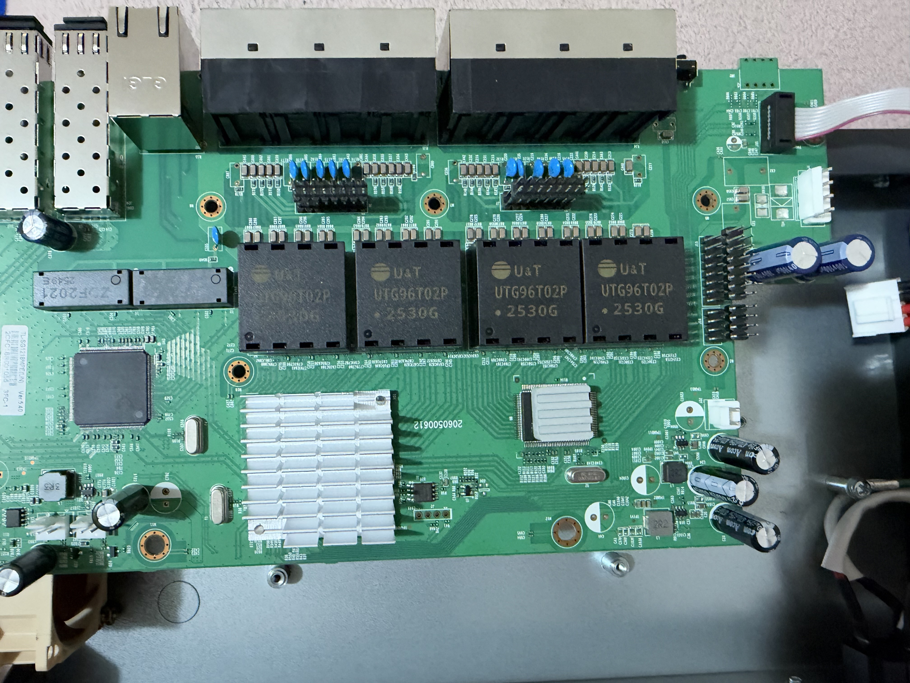

**Проверено по фото:** видны радиаторы, сетевые разъёмы и маркировка PCB
`2060500612`. Маркировки микросхем под радиаторами на этом снимке не читаются.

### Маркировка микросхемы

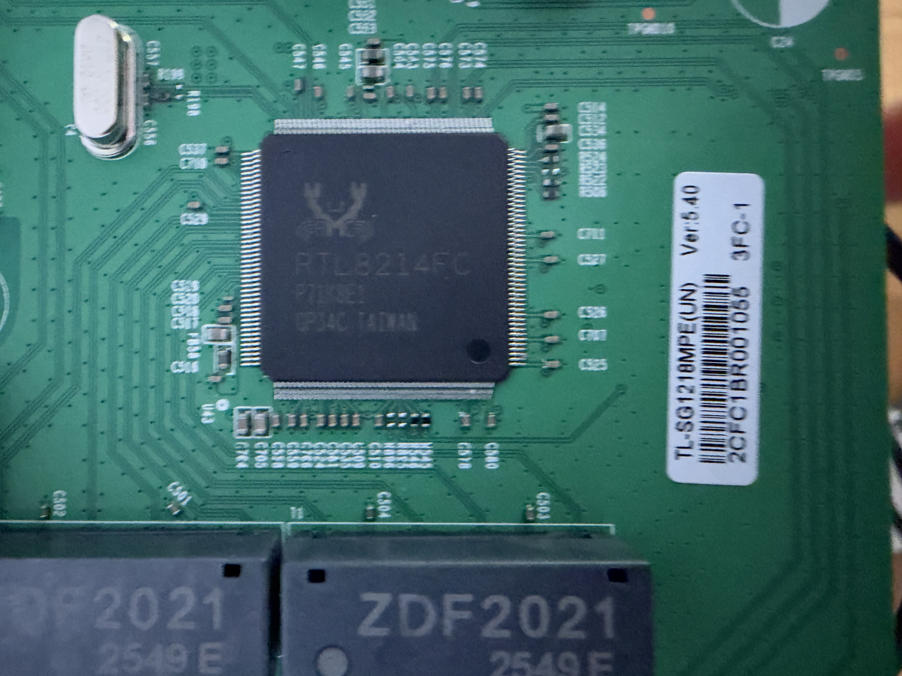

**Проверено по фото:** на открытой микросхеме читается `RTL8214FC`, на наклейке —
`Ver:5.40`. По одному этому снимку нельзя установить процессор, который исполняет
исследуемую прошивку; `RTL8214FC` здесь не объявляется моделью основного SoC.

<details>
<summary>Дополнительный крупный план той же области платы</summary>

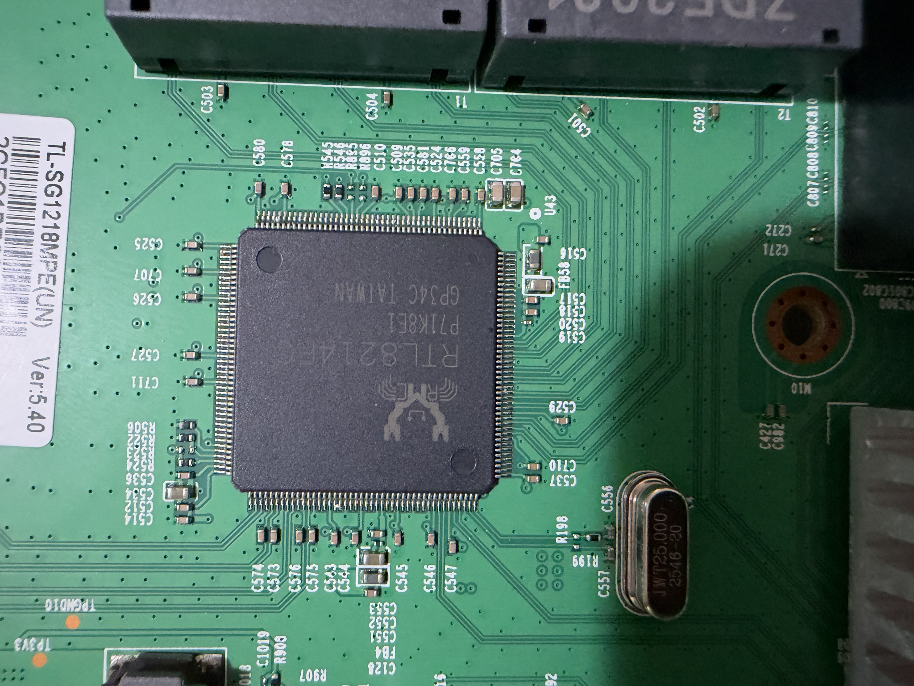

</details>

### Обратная сторона возле четырёх контактов

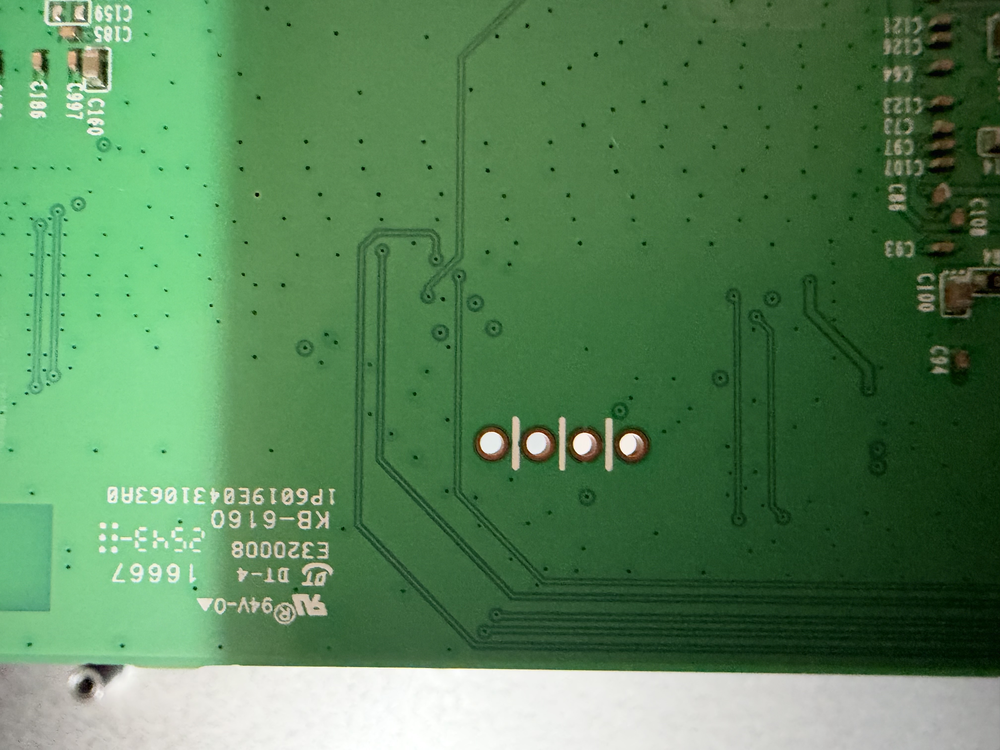

**Проверено по фото:** виден ряд из четырёх контактных отверстий и дорожки рядом.
**Проверено позднее на стенде:** pin 1 J2 по нумерации владельца выдаёт UART TX
на 38400 после установки R41/R42 по 0 Ом 0402. После загрузки v0.1.1
подтверждён и двусторонний обмен: команда `help` получает ответ. Ориентация этого снимка отличается от лицевой стороны;
номера контактов по расположению отверстий здесь не назначаются.

Фото добавлены по разрешению владельца без изменения пикселей, поворота или
скрытия наклеек. Исходные имена и SHA-256: [sources.json](docs/images/sources.json).

## UART на стенде

**Проверено на данном экземпляре 17.10.2026** по прозвонке и сообщениям владельца,
скриншоту PuTTY и полному тексту штатной загрузки:

| Параметр | Результат и источник |
| --- | --- |
| R41, R42 | **По 0 Ом, корпус 0402**. Владелец подтвердил последовательные разрывы прозвонкой и рабочую доработку. Заводской номинал по схеме не установлен |
| J2, pin 1 | **TX свитча → RXD USB-UART**; владелец подтвердил, что вывод идёт с pin 1 |
| J2, pin 2 | RX по описанному подключению владельца; двусторонний обмен подтверждён ответом на `help`, отдельного нового фото проводов нет |
| J2, pin 3 | GND по ранее сообщённой владельцем проверке; перед подключением другой платы проверить заново |
| J2, pin 4 | 3,3 В по измерению владельца. К питанию адаптера не подключать |
| Параметры порта | **38400 бод, 8N1, Flow control None**. Владелец: «38400 отлично работает» |
| Порт компьютера | COM3 на стенде владельца; на другом компьютере номер может отличаться |
| Подтверждённое поведение | Штатный boot log; после web-обновления v0.1.1 — загрузка, `RTK#`, ответ на `help` и `/stats.json` |
| Ещё не проверено | Восстановление, команды CLI кроме help, PoE под нагрузкой и длительная стабильность |

**Нумерация 1–4 здесь — нумерация владельца при измерениях.** Привязка к
ориентации фото и заводскому треугольнику отдельно не установлена. Не считать
верхний или нижний контакт pin 1 только по расположению снимка.

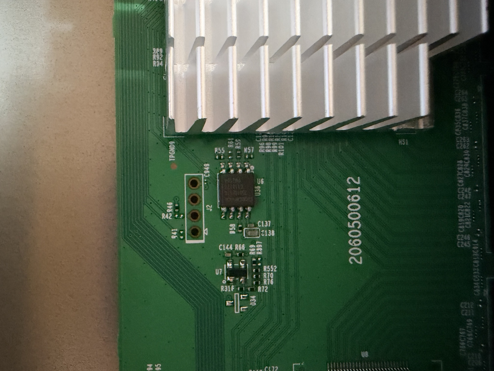

**Проверено по фото:** показана плата **до** установки R41/R42. Корпус 0402,
номинал 0 Ом и результат после доработки подтверждены владельцем; отдельного
фото установленной пары пока нет. Для другой платы до пайки нужно прозвонить
цепи: пустой резистор может иметь другое назначение.

Для двустороннего UART текущего стенда: GND → GND, pin 1 TX свитча → RXD
адаптера, pin 2 RX свитча ← TXD адаптера с совместимыми логическими уровнями.
VCC, 5V и 3V3 адаптера к свитчу не подключаются. При захвате только вывода
TXD можно оставить свободным. Пайка и перестановка проводов выполняются
при отключённом питании и отсоединённом USB-UART.

Настройки PuTTY: **Serial / COM3 / 38400**, **8 data bits / 1 stop bit /
Parity None / Flow control None**. Для сохранения сырых байтов закройте PuTTY
и выполните из корня репозитория:

```powershell
.\tools\start-uart.cmd -Port COM3 -Baud 38400 -OutputDirectory "$PWD\uart-logs"
```

После `LISTENING` включите стенд. Скрипт по умолчанию слушает 60 секунд,
ничего не отправляет и сохраняет `rx.bin`, `rx.txt`, `rx.hex.txt`, `session.json`.
[Подробная инструкция](docs/UART-CAPTURE.ru.md).

### Полный присланный лог штатной загрузки

**Проверено:** ниже весь текст, присланный владельцем; он также сохранён в
[boot-stock-38400.txt](docs/evidence/2026-10-17/boot-stock-38400.txt).
Это текст из чата, не исходный `rx.bin`. Сохранён целиком по запросу владельца.

```text
check runtime img
go to runtime addr 0xb4008010
uart 0 init!---------- Done!

flash driver init!---------- Done!

Config signature ok.
sal_config_init!---------- Done!

timer init!---------- Done!

soc interrupt init!---------- Done!

phy is 0xc984
get switch_mac = 58:4:4f:95:41:a1!---------- Done!

tddp_tsdp_dhcp_igmp trap cpu set ---------- Done!

QoS init ---------- Done!

DHCPC init!---------- Done!

IGMP init!---------- Done!

Trunk init!---------- Done!

port init!---------- Done!

port mirror init!---------- Done!

POE init!---------- Done!

vlan init!---------- Done!

SignCheck start!
SignCheck Pass.
Led init!---------- Done!

Config Restore!---------- Done!

HTTPD && TSDP init!---------- Done!

TDDP init!---------- Done!

set port 24 to copper mode
set port 25 to copper mode
set port 26 to fiber mode
set port 27 to fiber mode
 code init !---------- Done!
```

`SignCheck Pass.` показывает результат штатной загрузки, а не испытание нашего
патча. `phy is 0xc984` сохраняем как наблюдаемое значение, без вывода о точной
модели SoC. Номера 24–27 в логе — номера, выведенные прошивкой; их соответствие
лицевым портам этим логом не установлено. Строка `POE init ... Done!` не заменяет
испытание PoE с реальной нагрузкой.

### Скриншоты и история диагностики

**Проверено:** читаемое начало загрузки на рабочей скорости 38400, подтверждённой
владельцем. Скриншот показывает только начало; продолжение находится в тексте выше.

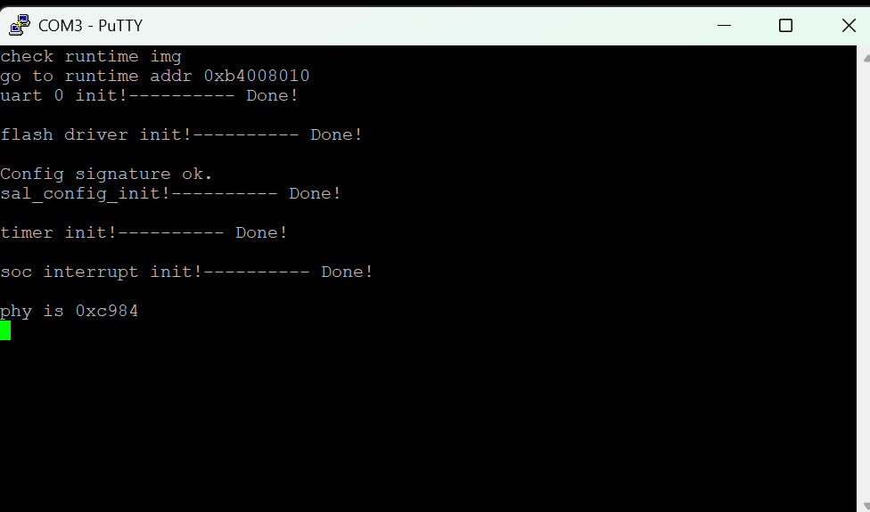

Остальные присланные UART-скриншоты сохранены ниже как история проверок.
115200 в старых снимках — параметры прежних тестов; рабочая скорость — 38400.

<details>
<summary>Петля COM3, 115200, PASS</summary>

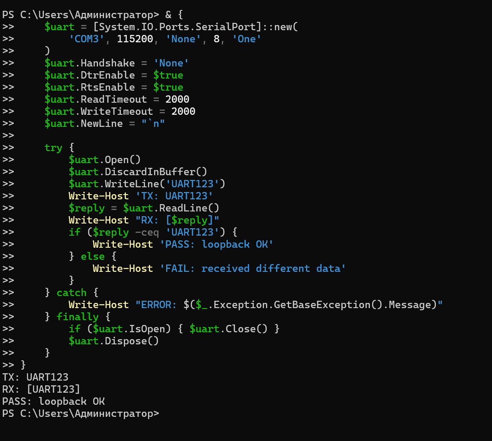

</details>

<details>
<summary>Первоначальная ошибка Join-Path до открытия порта</summary>

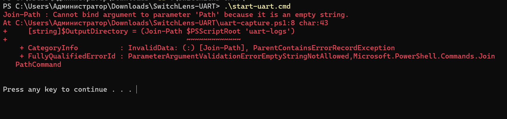

</details>

<details>
<summary>Pin 1: 0 байт при 115200 до доработки</summary>

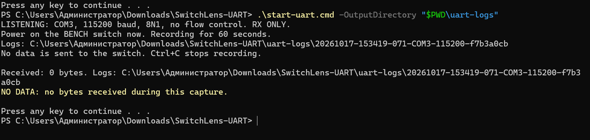

</details>

<details>
<summary>Повтор pin 1: владелец уточнил, что провод ещё не переставлял</summary>

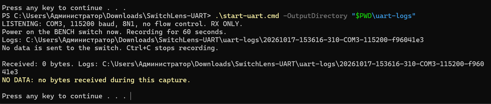

</details>

<details>
<summary>Pin 2: 0 байт при 115200 до доработки</summary>

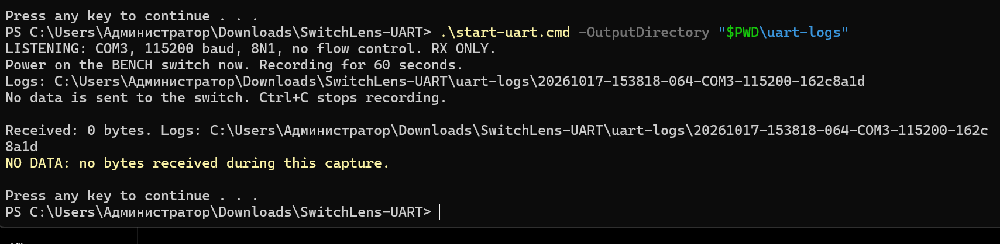

</details>

<details>
<summary>Нечитаемые символы до выбора рабочей скорости</summary>

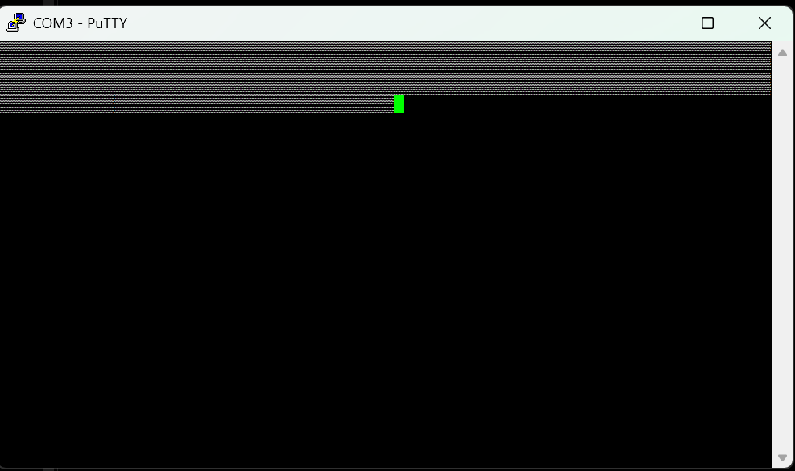

</details>

<details>
<summary>Исторические настройки 115200; рабочая скорость затем установлена 38400</summary>

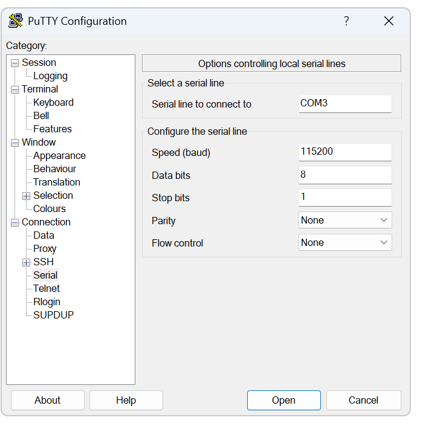

</details>

Исходные файлы не изменялись. Имена загрузок и контрольные суммы:
[sources.json](docs/images/sources.json). Область доказанности каждого результата:
[журнал стенда](docs/evidence/2026-10-17/README.ru.md).

## Успешное испытание SwitchLens: 17.10.2026

[Полный журнал с сообщениями владельца и восьмью скриншотами](docs/evidence/2026-10-17-switchlens/README.ru.md).

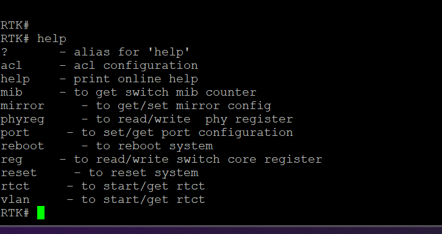

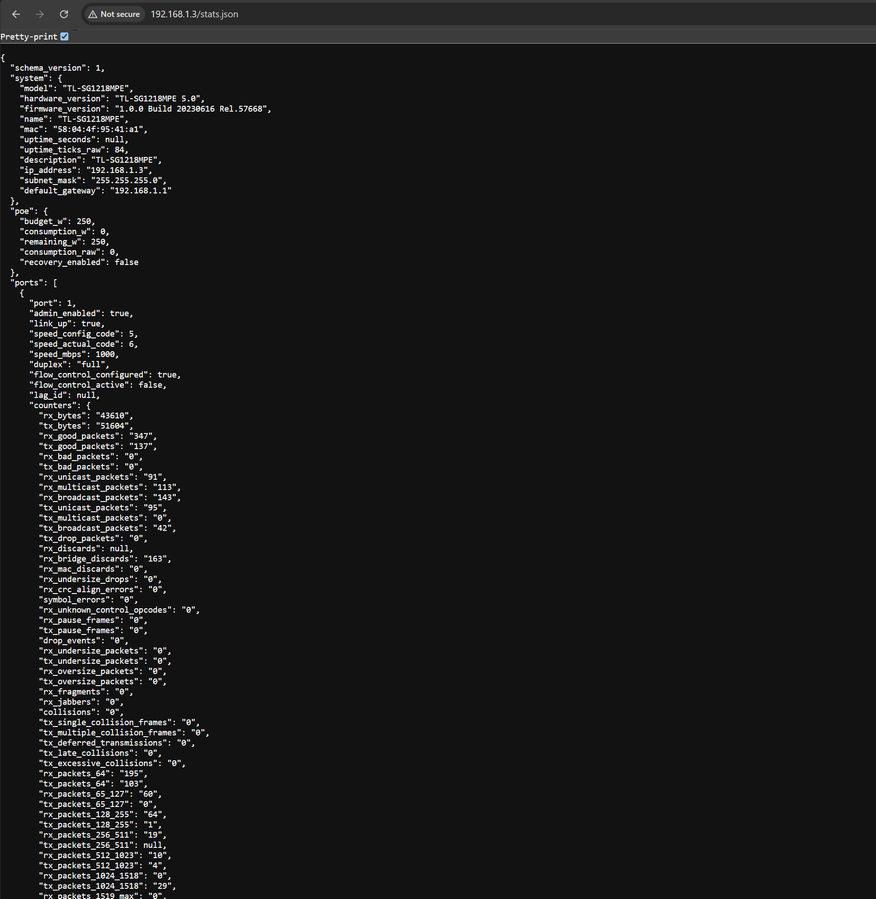

Порт 1 сообщает 1000 Мбит/с, full duplex. Между двумя ответами RX bytes выросли
с 43 610 до 528 836, TX bytes — с 51 604 до 103 534; raw uptime — с 84 до 614.
Точный интервал не измерен. PoE сообщает 0 Вт при бюджете 250 Вт; проверка
потребителя под нагрузкой ещё предстоит. Значение `rx_bridge_discards` растёт,
его причина не установлена. [Полная расшифровка полей и ограничений](docs/JSON-API.ru.md).

## Быстрый запуск на компьютере

```bash
python3 -m venv .venv
. .venv/bin/activate
python3 -m pip install -r requirements-dev.txt
make test
./build/fixture > demo.synthetic.json
```

Проверено: эти тесты не обращаются к коммутатору и не меняют образ прошивки.
Нужны C99-компилятор, make и Python3. CI использует Ubuntu и Python3.12.
Локально проверены GCC и ASan/UBSan; запуск GitHub Actions ещё не выполнен.

```bash
make sanitize
python3 tools/generate_fields.py
git diff --exit-code -- include/sg_fields.h src/sg_fields.inc
```

В среде с ограничением ptrace LeakSanitizer может не запускаться. Для такой
среды проверено `ASAN_OPTIONS=detect_leaks=0 make sanitize`; ASan/UBSan остаются
включены. Причина и результаты описаны в [IMPLEMENTATION](docs/IMPLEMENTATION.txt).

## Структура

| Каталог | Содержание |
|---|---|
| `src/`, `include/` | Потоковый JSON и экспериментальное чтение MIB |
| `target/` | MIPS-маршрут, адаптер официального образа, linker script |
| `tests/` | Синтетические источники, транспорт, граничные проверки |
| `schema/`, `examples/` | Контракт и примеры без реальных сетевых данных |
| `tools/` | Генерация таблиц, статический анализ и локальная сборка BIN |
| `research/` | Факты, смещения, карты источников и история выводов |
| `docs/` | Ограничения, этапы, результаты и подготовка стенда |
| `releases/` | Версионный экспериментальный BIN, SHA-256 и манифест сборки |
| `vendor/tp-link/tl-sg1218mpe-v5/` | Четыре официальных ZIP/BIN TP-Link, инструкции производителя и SHA-256 |
| `backups/original/2026-10-17/` | Неизменённый экспорт ПЗУ конкретного экземпляра, SHA-256 и анализ |
| `docs/datasheets/` | PDF Realtek и GigaDevice GD25Q16B с происхождением и контрольными суммами |

## Исследуемая версия

Проверено для предоставленного файла `1.0.0 Build 20230616 Rel.57668`:

```text
SHA-256 c9ab17eda7af714f00692d41f440ce84ed0d6c7d678634c364ec1154bb7e3f32
```

Официальный исходный образ теперь [сохранён в репозитории](vendor/tp-link/tl-sg1218mpe-v5/README.ru.md)
по запросу владельца вместе с версиями 20220921, 20221012 и 20230220.
Аудит сначала проверяет SHA-256:

```bash
python3 tools/audit.py /path/to/firmware.bin
python3 tools/audit_mib.py /path/to/firmware.bin > local-mib-map.json
python3 tools/audit_platform.py /path/to/firmware.bin > local-platform-evidence.json
```

Проверено новым статическим разбором: runtime `SignCheck` хеширует UID устройства;
проверки отдельного загрузчика из update BIN не установлены. Между RAM-кодом и
initial SP — 4800 байт, причём штатные функции уже используют большие кадры стека.
Подробности и смещения: [PLATFORM-FOLLOWUP](research/PLATFORM-FOLLOWUP.ru.md).

Найдены опубликованные примеры модификации Easy Smart и родственных Realtek:
[PRIOR-ART](research/PRIOR-ART.ru.md). Они подтверждают наличие подходов и кода для
изучения, но не совместимость чужих образов с TL-SG1218MPE V5.0.

По прямым запросам владельца в Git включены исходный экспорт SPI в
`backups/original/2026-10-17/`, присланный UART-лог в `docs/evidence/2026-10-17/`,
его скриншоты и фото платы. По новому прямому запросу сохранены также материалы
успешного испытания в `docs/evidence/2026-10-17-switchlens/`, включая реальные
JSON данного стенда. Будущие журналы и сетевые данные не добавляются автоматически. Версионный модифицированный BIN включён в `releases/`.
Доказательства маркируются «проверено»,
непроверенные выводы — «гипотеза». Статическое чтение инструкций не заменяет
проверку поведения ASIC. Исходные отчёты в `research/` сохраняют историю;
актуальный статус — этот README и [ROADMAP](docs/ROADMAP.ru.md).

## Следующие этапы

Офлайн-проверка и первое аппаратное испытание v0.1.1 выполнены. Подтверждены
загрузка, UART CLI и два изменяющихся JSON. Следующие задачи — сверка со штатной
панелью, реальные PD/PoE, причины discards, физическая нумерация портов,
единица uptime и длительный опрос под нагрузкой. Восстановление пока не проверено;
владелец отказался от повторной выпайки ради предварительного теста.
Этот единственный свитч пока не введён в эксплуатацию. После стендовых испытаний
решение о внедрении принимается отдельно.
См. [стенд](docs/LAB.ru.md) и [план](docs/ROADMAP.ru.md).

Проект независимый, не официальный продукт TP-Link. Лицензия для публикации
исходников пока не выбрана. Официальные образы производителя находятся в
`vendor/tp-link/tl-sg1218mpe-v5/`; экспериментальный модифицированный BIN — в `releases/`.
Права на официальные прошивки и даташиты принадлежат их правообладателям.

Клонирование репозитория и работа с Git: [GITHUB](docs/GITHUB.ru.md).

Исключение по прямому запросу владельца от 2026-10-17: исходный экспорт
GD25Q16B включён без изменений в `backups/original/2026-10-17/`
вместе с SHA-256 и результатами первичной проверки. Остальные дампы
не добавляются автоматически.

Документация ПЗУ: [сам PDF GD25Q16B rev. 2.3](docs/datasheets/GD25Q16B_Datasheet_2.3.pdf),
[распиновка U6 и указатель страниц](docs/datasheets/README.ru.md#пзу-u6-gd25q16bsig).
Для восстановления различайте официальный update BIN и полный экспорт SPI:
[описание файлов](vendor/tp-link/tl-sg1218mpe-v5/README.ru.md).
