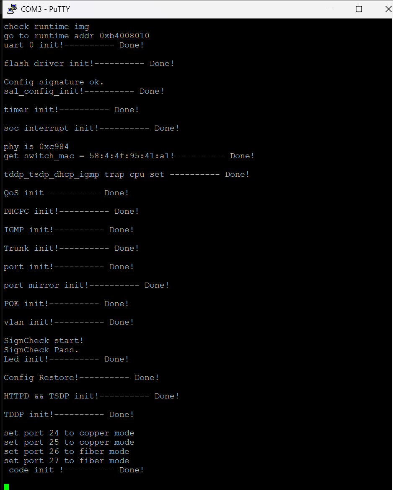
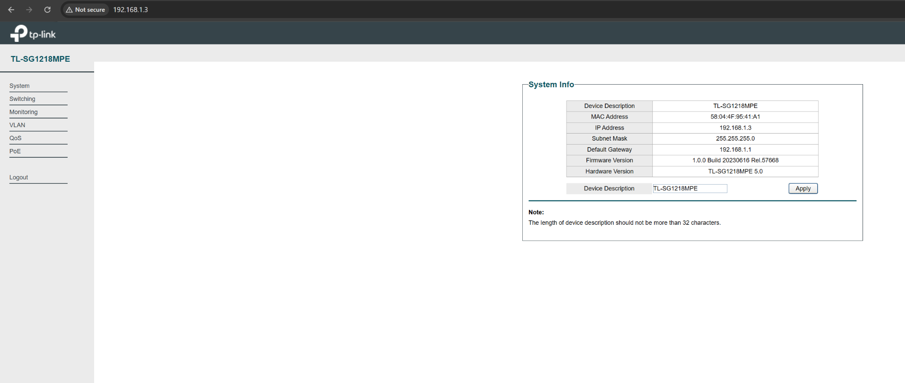
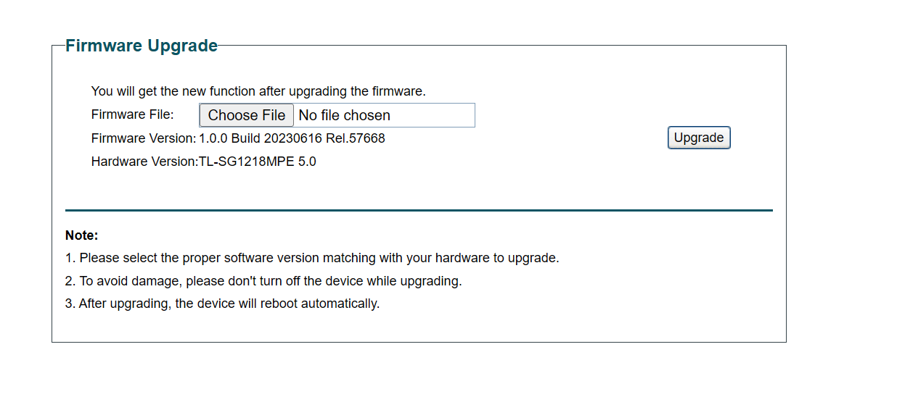
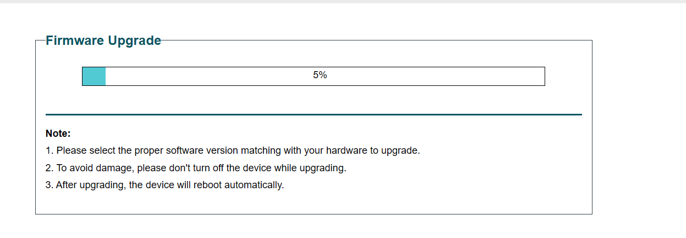
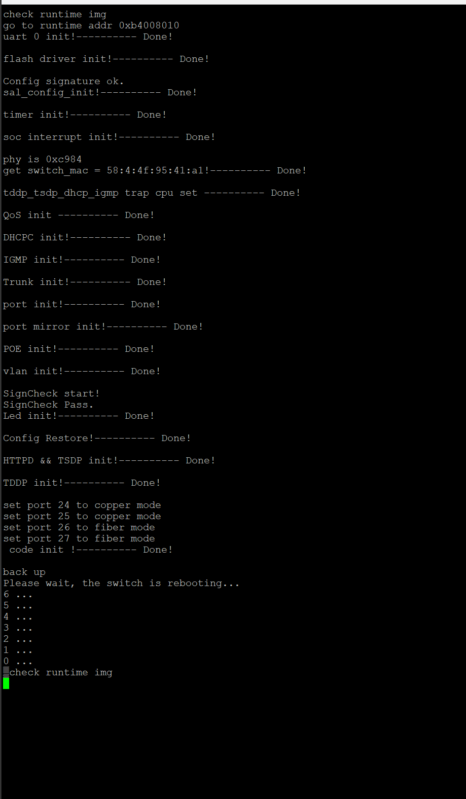
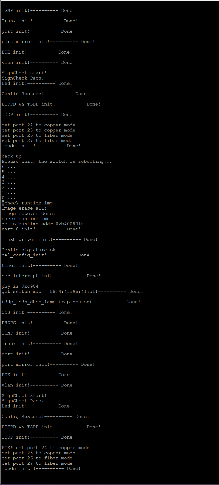

[English](README.md) | **Русский**

# Первое успешное испытание SwitchLens на устройстве

**17 октября 2026, стенд владельца.** TL-SG1218MPE(UN) V5.0,
плата с маркировкой Ver:5.40. Аппаратные действия выполнял владелец;
проверка опубликованных файлов выполнена по его сообщениям и вложениям.
Удалённого доступа к самому свитчу в этой проверке не было.

**Результат:** после штатного web-обновления запустилась основная прошивка,
появился `RTK#`, команда `help` получила ответ. `/stats.json` открылся в браузере;
два полных ответа соответствуют схеме и показывают изменение счётчиков.

**Прошивка рабочая:** это первая подтверждённая работа обеих функций на данном экземпляре.
Она не означает завершённую проверку всех метрик, PoE под нагрузкой,
отката или длительной стабильности.

## Какой образ испытывался

В текущем сеансе владельцу был опубликован и передан
[v0.1.1-experimental-uart](../../../releases/v0.1.1-experimental-uart/README.ru.md):
`SwitchLens-SG1218MPE-V5-v0.1.1-experimental-uart.bin`, 1 013 324 байта.

```text
SHA-256 27e4fce8d5c0c2999a324341cea7e96e37b1c0561e8d6a3218705b32b7aeee71
```

[GitHub Release](https://github.com/adsdevdoo/switchlens-sg1218/releases/tag/v0.1.1-experimental-uart).
Внутренняя строка `1.0.0 Build 20230616 Rel.57668` намеренно сохранена.
Скрин формы до выбора файла не показывает имя выбранного BIN; хеш прочитанного
обратно образа устройства не получен. Привязка испытания к пакету основана
на последовательности сеанса и совместном появлении UART CLI и JSON.
Указанный SHA относится к опубликованному файлу, не к чтению флеша после обновления.

## Хронология действий и доказательства

| Шаг владельца | Что видно в присланных материалах | Что установлено |
| --- | --- | --- |
| Подготовил UART и открыл PuTTY | Читаемый штатный boot log; ранее сообщил «я выставил 3.3 на адаптере» | Приём вывода работает; положение переключателя само по себе не измерение TXD |
| Нажимал клавиши до модификации | Сообщил об отсутствии ответа | Позже статически установлен отключённый штатный CLI; этот опыт не доказывал плохую пайку |
| Открыл System Info и Firmware Upgrade | Модель TL-SG1218MPE, Hardware 5.0, исходная версия; форма обновления | Штатный web доступен |
| Запустил web-обновление | Progress 5%, затем `back up` и обратный отсчёт в UART | Запущено обновление и перезагрузка |
| Дождался загрузки | `Image erase all!`, `Image recover done!`, переход в runtime, `SignCheck Pass.`, `RTK#`, `code init` | Основная прошивка стартовала, CLI вывел приглашение |
| Ввёл `help` | Список команд и следующий `RTK#` | Работают ввод и вывод UART; программный обработчик команд исполняется |
| Открыл `/stats.json` | Скрин браузера и первый полный текст | Получен JSON с 18 портами |
| Повторно открыл/обновил JSON и прислал текст | Второй полный текст | Значения счётчиков и raw uptime изменились |

Фиксируется порядок сообщений, а не точный секундомер: независимых временных
меток HTTP-запросов нет. Не принимаем предложенный интервал «30 секунд» за
фактически измеренный. По разности uptime 530 ticks нельзя установить секунды/tick.

### До обновления: штатный UART и веб-панель





### Штатное web-обновление







### Загрузка изменённого runtime



Полный присланный текст: [boot-after-upgrade.txt](boot-after-upgrade.txt).
Это текст из сообщения, не сырая запись UART-байтов.
Последовательность `Image erase all!` → `Image recover done!` согласуется
с исследованным путём копирования staged-образа в рабочую область; сами эти
слова не доказывают аварийный откат. После них реально наблюдаются обе добавленные
функции. Трассировки каждой операции записи flash на стенде нет.

`SignCheck Pass.` — наблюдение штатной проверки runtime, не сертификат
побайтовой целостности всего установленного BIN. Долговременная работа портов
и питание PD не доказываются строками `port init` / `POE init`.

### UART: команда `help`


Присланный текст: [uart-help.txt](uart-help.txt).
Подтверждены приглашение, ввод `help` и получение списка. Исполнение остальных
команд из списка не проверялось; среди них есть команды изменения/сброса.
Это консоль основной прошивки, не установленный путь восстановления загрузчика.

Настройки текущего стенда: CP2102, COM3, **38400, 8N1, Flow control None**.
R41/R42 установлены по 0 Ом, 0402. В текущем подключении приём команд подтвердился;
J2 pin 1 — TX, pin 2 — RX по нумерации владельца, pin 3 — GND.
Питание адаптера к pin 4 не подключается. Нового фото проводов в этом сеансе нет:
скриншот `help` доказывает двусторонний обмен, а привязка к pin 2 опирается
на описанное подключение стенда.

### `/stats.json`: первый ответ


Скриншот содержит только часть JSON. Для проверки использованы **полные тексты**:

- [Первый ответ](stats-01.json), [исходное вложение Markdown](stats-01-submitted.md).
- [Второй ответ](stats-02.json), [исходное вложение Markdown](stats-02-submitted.md).
- [Машинный результат проверки и все различия](validation-results.json).
- [Подробное описание JSON](../../JSON-API.ru.md).

## Сравнение двух ответов

Оба файла разобраны JSON-парсером и проверены по текущей
[`schema/stats.schema.json`](../../../schema/stats.schema.json): **0 ошибок**.
В каждом присутствуют ровно 18 портов, по порядку 1–18; все строковые счётчики
укладываются в `uint64`. Это проверка структуры и диапазона, не калибровка метрик.

| Показатель | Первый ответ | Второй ответ | Разность |
| --- | ---: | ---: | ---: |
| `system.uptime_ticks_raw` | 84 | 614 | +530 |
| Порт 1 `rx_bytes` | 43 610 | 528 836 | +485 226 |
| Порт 1 `tx_bytes` | 51 604 | 103 534 | +51 930 |
| Порт 1 `rx_good_packets` | 347 | 4 702 | +4 355 |
| Порт 1 `tx_good_packets` | 137 | 435 | +298 |
| Порт 1 `rx_bridge_discards` | 163 | 3 870 | +3 707 |

В обоих ответах порт 1 сообщает link up, 1000 Мбит/с, full duplex; остальные
порты — link down. `rx_crc_align_errors`, `symbol_errors`, `collisions` и
штатные bad-packet агрегаты равны нулю. Дополнительные имена MIB по-прежнему
экспериментальны; причины роста `rx_bridge_discards` не установлены.

PoE: budget 250 Вт, consumption 0 Вт, remaining 250 Вт; порты 1–16 разрешены
в конфигурации, но сообщают `OFF`, измерения по портам — `null`. Порты 17–18:
`poe: null`. Это согласованный вывод реализации, а не результат теста реального PD.

Наблюдается config speed code 5 на портах 1–5, 2 на 6–16 и 1 на 17–18;
они не менялись между ответами. Соответствие этих настроек штатной странице
Port Setting ещё не сверено. Не трактуем конфигурационный код как actual speed.

## Что подтверждено и что осталось

| Проверка | Статус |
| --- | --- |
| Приём web-обновления и старт runtime | Подтверждены показанной последовательностью |
| UART CLI: `RTK#`, `help`, двусторонний обмен | Подтверждены на экземпляре владельца |
| Доступность `/stats.json`, 18 портов, валидная схема | Подтверждены двумя полными ответами |
| Изменение uptime и счётчиков между запросами | Подтверждено сравнением файлов |
| Полная идентичность flash опубликованному BIN | Чтение после прошивки не прислано |
| Все настройки/метрики против штатного UI и известного трафика | Предстоит |
| PoE под нагрузкой, классы PD, напряжение/ток/мощность | Предстоит |
| Причина `rx_bridge_discards`, переполнение/сброс, побочные эффекты чтения | Предстоит |
| Единица времени uptime, допустимая частота опроса | Не установлены |
| Длительная нагрузка, несколько клиентов, обрывы HTTP | Не испытаны на железе |
| Откат/восстановление | Не проверены; повторная выпайка ради предварительного теста владельцем отклонена |

## Происхождение материалов

Владелец прямо попросил: «сделай подробное описание для json и выложи наши
успешные результаты в github с сообщениями и скринами что я делал».
В рамках этого запроса публикуются присланные сетевые данные данного стенда,
тексты и скриншоты. Паролей/cookies в отобранных материалах нет.

[Выдержки сообщений и связь с материалами](messages.ru.md).
Это подборка относящихся к испытанию сообщений, не полная стенограмма чата.
Скриншоты и исходные Markdown-вложения скопированы **без изменения байтов**.
Извлечённые `.json` отличаются только удалением Markdown-ограды и внешних
пробельных символов. [sources.json](sources.json) содержит исходные имена,
преобразования и SHA-256; [SHA256SUMS](SHA256SUMS) покрывает все файлы этой папки,
кроме самого файла контрольных сумм.

Публикация этой сессии не означает автоматического разрешения на будущие
журналы. BIN, исходный SPI-экспорт и ранее выпущенные артефакты проверки
не изменялись. Их прежние статусы описывают момент до аппаратного испытания;
текущие результаты находятся в этом документе.
